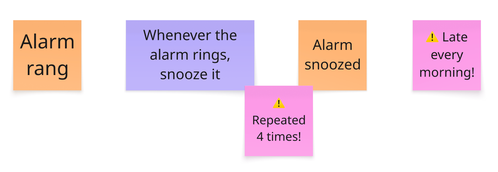
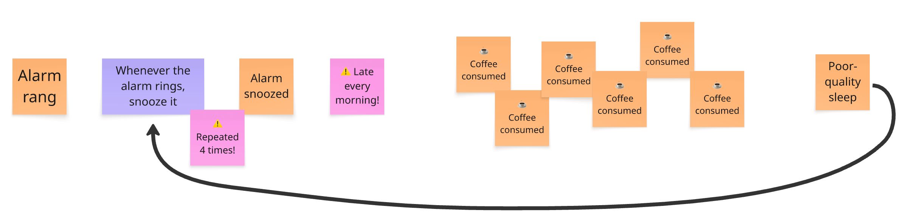
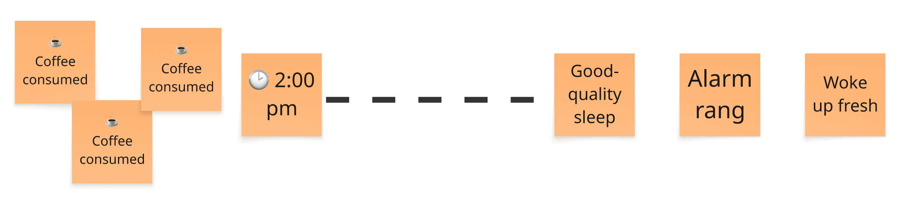

_TODO Lead statement_

How many times did you snooze this morning?

Four, if your mornings look like the one in [our first post]({{site.url}}{{site.baseurl}}/foundations/essence-of-event-storming/). Back then, we said that this count was no accident. It's a behavior, and something in the structure of your life causes it.

You now know enough to find out what.

This is the tip of the iceberg. If you continue the exploration, you discover:

A vicious circle. That's the structure under the surface, and the reason the alarm rings four times. Our first post blamed caffeine without showing how. Now it's on the wall.

Move the last coffee before 2 pm. One small action that breaks the loop!

## Find your first Event Storming

Now is the perfect moment to run your first workshop.

To help you take the first step, look back at your last week for these Event-Storming-prone situations:

* **You keep chasing the same experts for domain knowledge**. Your third one-to-one this week, just to understand how refunds really work.
* **Coordination between experts eats your week**. A 40-reply email thread with Sales, Legal and Ops, all CC'd, and still no decision.
* **Important knowledge shows up too late.** "Oh, didn't anyone tell you? Premium customers get invoiced differently." Someone said this the day before release.
* **The team can't agree on how to split the work or the system.** Two hours at the whiteboard deciding who owns "Order", and the meeting ends with "let's take this offline".
* **Newcomers struggle to see how the business works end to end.** Three weeks in, the new joiner still asks, "Wait, who sends the invoice?"
* **Nobody sees the whole picture, so a big decision stalls.** "Rewrite or buy?" is on the steering committee agenda for the third month running.

In these situations, start with Big Picture Event Storming, and dig into important subdomains with Design Level Event Storming.

When the pain is in how the team works rather than in the domain, run [Event Storming the Flow]({{site.url}}{{site.baseurl}}/workflow%20improvement/3-questions-to-know-if-event-storming-the-flow-could-help-you/):

* **The same problem keeps coming back**. It's on the retrospective board for the fourth sprint in a row, and the action items never stick.
* **Everyone is busy, yet work ships late.** Every developer works at full capacity, and the feature promised for March ships in June.
* **Firefighting crowds out planned work.** Half the sprint goes to urgent support tickets, and the roadmap slips again.

Do you need a big budget or a big room? All you need is one ally, a few experts, a wall, and a 1h30 session. Look for allies among colleagues who complain about the same problem as you. Go back to [the Big Picture step-by-step guide]({{site.url}}{{site.baseurl}}/big%20picture/step-by-step-guide-to-run-your-big-picture-event-storming/) for the agenda, or to [the Flow steps]({{site.url}}{{site.baseurl}}/workflow%20improvement/follow-these-steps-to-visualize-your-workflow-with-event-storming/) for your workflow, and give it a try.

## Final words

Collaboration is losing ground. Agents now write much of our code and many developers spend more time talking to their agents than to each other. Shared understanding used to grow as a side effect of working together. A wall of stickies does what an agent can't: it puts people side by side, building the same understanding. Each Event Storming you run brings a few more people back to the same wall.

Don't hit snooze! Pick one situation from your week and book the session. When you have run it, tell us how it went in the comments below, or on LinkedIn ([Philippe](https://www.linkedin.com/in/philippe-bourgau-607a928), [Matthieu](https://www.linkedin.com/in/matthieu-tournemire/)). And don't forget that [the community has your back]({{site.url}}{{site.baseurl}}/foundations/need-help-with-event-storming-the-community-has-your-back/).

Thank you for following us through this journey. We wish you a happy Event Storming!