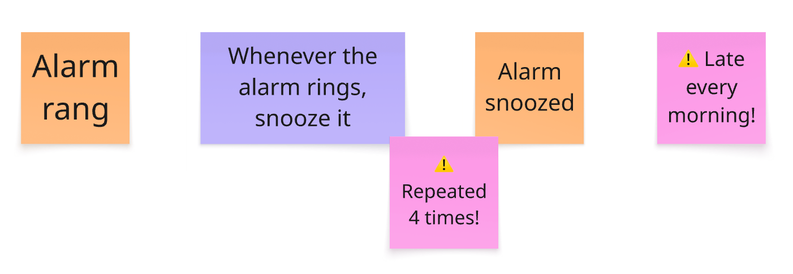
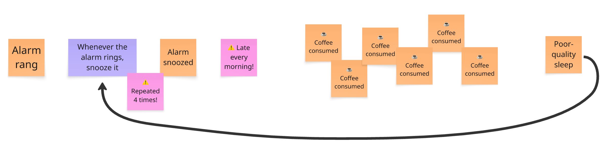
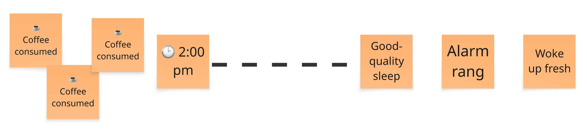

# Conclusion: Don't Snooze Your First Event Storming {#conclusion--snooze}

::: {.lead-statement data-latex=""}
ℹ️ **In this chapter:** _Spot the situations from last week that call for an Event Storming, find a wall and an ally, then book a 90-minute session._
:::

How many times did you snooze this morning?

Four, if your mornings look like the one in [the first chapter](#essence-of-event-storming). Back then, we said that this count was no accident. **Snoozing is a behavior, and something in the structure of your life causes it.**

You now know enough to find out what.

These stickies are the tip of the iceberg. Keep exploring and you discover:

**A vicious circle. That's the structure under the surface, and the reason the alarm rings four times.** The first chapter blamed caffeine without showing how. Now the wall shows how.

Move the last coffee before 2 pm. **One small action breaks the loop.**

## Find your first Event Storming {#conclusion--find}

**Run your first workshop now.**

Look back at last week for these situations:

* **You keep chasing the same experts for domain knowledge.** Your third one-to-one this week, just to understand how refunds really work.
* **Coordination between experts eats your week.** A 40-reply email thread with Sales, Legal, and Ops, all CC'd, and still no decision.
* **Important knowledge shows up too late.** "Oh, didn't anyone tell you? Premium customers get invoiced differently." Someone said this the day before release.
* **The team can't agree on how to split the work or the system.** Two hours at the whiteboard deciding who owns "Order," and the meeting ends with "let's take this offline."
* **Newcomers struggle to see how the business works end to end.** Three weeks in, the new hire still asks, "Wait, who sends the invoice?"
* **Nobody sees the whole picture, so a big decision stalls.** "Rewrite or buy?" is on the steering committee agenda for the third month running.

In these situations, **start with [Big Picture Event Storming](#big-picture), then dig into key subdomains with [Design Level](#design-level).**

**When the pain lies in how the team works, not the domain, run [Event Storming the Flow](#flow--3-questions)**:

* **The same problem keeps coming back.** It's on the retrospective board for the fourth sprint in a row, and the action items never stick.
* **Everyone is busy, yet work ships late.** Every developer works at full capacity, and the feature promised for March ships in June.
* **Firefighting crowds out planned work.** Half the sprint goes to urgent support tickets, and the roadmap slips again.

Do you need a big budget or a big room? **All you need is one ally, a few experts, a wall, and a 90-minute session.** Look for allies among colleagues who complain about the same problem. Reread [the Big Picture step-by-step guide](#big-picture--guide) for the agenda, or [the Flow steps](#flow--steps) for your workflow. Then give it a try.

## Final words {#conclusion--final-words}

Collaboration is losing ground. Agents now write much of our code. Many developers talk to their agents more than to each other. Shared understanding used to grow as a side effect of working together. **A wall of stickies does what an agent can't: it puts people side by side, building that understanding together.** Each Event Storming you run brings a few more people back to the same wall.

**Don't hit snooze! Pick one situation from your week and book the session.** When you have run it, tell us how it went on LinkedIn ([Philippe](https://www.linkedin.com/in/philippe-bourgau-607a928), [Matthieu](https://www.linkedin.com/in/matthieu-tournemire/)). Remember, [the community has your back](#tips--community).

Thank you for reading this book. We wish you a happy Event Storming!
